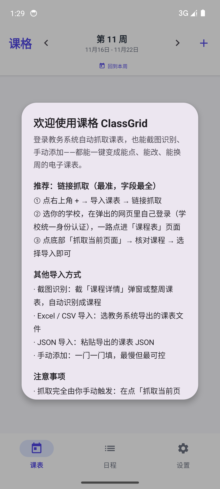
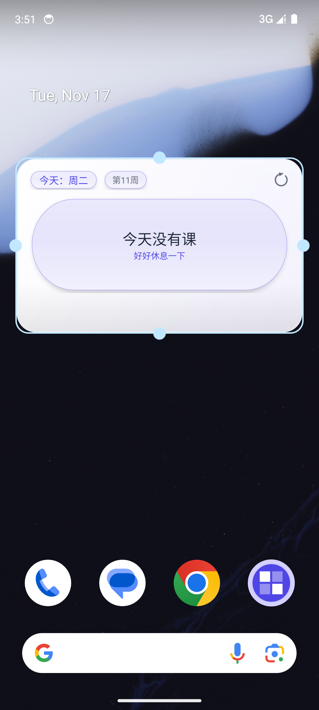

# 课格 ClassGrid

一个**离线优先**的 Android 课程表 App：原生 Kotlin + Material 3，无账号、无服务器、无广告，所有数据都留在本机。

导入课表有三条路，挑顺手的用：

- **教务截图 OCR**：直接把教务系统的课表截图丢进来，本机离线识别成课程；
- **Excel / CSV**：教务导出的 `.xlsx` / `.xlsm` / `.xls` / `.csv` / `.tsv` 选文件即导入，表头认「周一 / 一 / 一 11/2 / Mon」，格内多门课自动拆分，周次支持「1-16周 / 单双周 / 1-8,10-16周」；
- **链接抓取**：先选学校（内置 2868 所）→ 打开该校教务系统入口 → 你自己登录、翻到课表页 → 点「抓取当前页面」。

## 截图

| 课表 | 桌面小组件 |
|------|------------|
|  |  |

## 功能

- **周视图课表**：15 节、双指缩放、左右滑动、周次宫格切换
- **日程纵览**：日期胶囊条 + 上课中 / 下一节课状态
- **多课表**：新建 / 切换 / 重命名 / 删除；导入时可「合并到当前 / 覆盖当前 / 新建并导入」
- **自定义日程**：手动添加带精确起止时间的日程，按时间比例画进课表
- **桌面小组件**：胶囊风格，顶部「今天：周X」+「第N周」，中间主课大胶囊（正在上课时显示「还剩 N 分」），底部下一节；全部上完显示「今天的课程已经结束」。整卡用 Canvas 绘制成 Bitmap 交给 RemoteViews，零新增依赖。可自由缩放（2×2 / 4×2 / 4×4…），颜色跟随主题与系统深浅色
- **日历导出（.ics）**：单双周 / 排除周用 RRULE + EXDATE，事件带 TZID + VTIMEZONE，导入系统日历后由日历提醒
- **通知栏常驻**：长期显示今天的课与倒计时，两个按钮「刷新 / 关闭」
- **作息时间自定义**：节次数量、每节起止时间可改，作息可存库复用，内置几套常见作息预设
- **外观**：经典 / 墨玉 / 极光三套色系，各带浅色与深色，可跟随系统
- **自动更新**：打开 App 静默检查（24 小时一次），下载后校验大小与 SHA-256，最后一步走系统安装器
- **新手引导**：首次打开逐步点击的五步引导

## 下载

最新安装包在 [Releases](../../releases) 里。安装前建议先卸载旧版本，避免签名冲突。

## 构建

| 项目 | 要求 |
|------|------|
| JDK | 17 |
| Android SDK | `compileSdk = 34` / `targetSdk = 34` / `minSdk = 24` |
| Gradle | 自带 Wrapper 8.5，首次运行自动下载（分发地址已配腾讯云镜像） |
| 依赖仓库 | 已配阿里云 Maven 镜像，国内可直接拉 |

```bash
# 1. 准备 SDK 路径
cp local.properties.example local.properties   # 把 sdk.dir 改成你的 Android SDK 路径

# 2. 编译
./gradlew assembleDebug          # 产物 app/build/outputs/apk/debug/app-debug.apk
./gradlew assembleRelease        # 产物 app/build/outputs/apk/release/app-release.apk

# 只出某一个 ABI 的包（显著更快更小）
./gradlew assembleRelease -PclassgridAbis=x86_64
```

Windows 用 `gradlew.bat`；没有 Android Studio 也能命令行构建。

## 签名

仓库**不含**任何签名密钥。想打自己的 release 包，在 `local.properties`（已在 `.gitignore` 里）写：

```properties
classgrid.keystore=../release.keystore
classgrid.storePassword=你的口令
classgrid.keyAlias=classgrid
classgrid.keyPassword=你的口令
```

也可以用环境变量 `CLASSGRID_KEYSTORE` / `CLASSGRID_STORE_PASSWORD` / `CLASSGRID_KEY_ALIAS` / `CLASSGRID_KEY_PASSWORD`。
没配置时 release 包会退回 debug 签名——能装能跑，但没法覆盖官方包升级。

## 目录结构

```
app/src/main/java/com/classgrid/app/
├── MainActivity.kt          # 课表 Tab + 日程 Tab、底部导航、周次弹窗、FAB
├── ScheduleView.kt          # 自定义 Canvas 课表（缩放 / 滚动 / 卡片排版）
├── OcrParser.kt             # 截图文本 → 课程（多级解析 + 清洗）
├── ImportActivity.kt        # 选图、预处理、ML Kit 识别、重试
├── OcrResultActivity.kt     # 识别结果核对页
├── CourseEditActivity.kt    # 手动添加 / 编辑课程
├── WebImportActivity.kt     # 链接抓取（内嵌 WebView）
├── TodayWidgetRenderer.kt   # 小组件 Canvas 绘制
├── TodayWidgetProvider.kt   # 小组件 RemoteViews 组装
├── Course.kt / CourseStore.kt  # 数据模型与 JSON 持久化（原子写 / 备份）
└── ...
docs/                        # 架构、审计、迭代日志、教务系统调研
```

更细的文档见 `docs/`：`ARCHITECTURE.md`（架构）、`DEVLOG.md`（迭代日志与踩坑）、`AUDIT.md`（问题清单与修复状态）、`JWXT_RESEARCH.md`（教务系统实测）、`CHANGES.md`（逐版本变更）。

## 数据与隐私

- 课程、日程、设置全部存在 App 私有目录的 JSON 里，**不上传任何服务器**；
- OCR 用系统内的 ML Kit，**离线识别**；
- 链接抓取用 WebView 让你自己登录，App **不读也不存**账号密码，不绕验证码；
- App 没有联网权限以外的后台服务（通知栏用 ongoing 通知 + 边界闹钟，不跑前台服务）。

## 已知限制

- 抓取导入依赖各校教务系统的页面结构，学校改了版可能要跟着改；
- 桌面小组件不支持连续动画，进行中的倒计时是每分钟刷新一次；
- 自动更新的清单地址硬编码在 `UpdateConfig.kt`，自己部署请改这里。

## 协议

[MIT](LICENSE)。随便用、随便改，保留版权声明即可。
